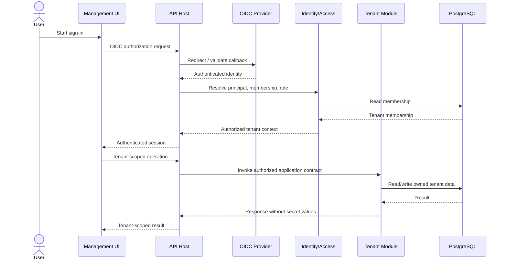
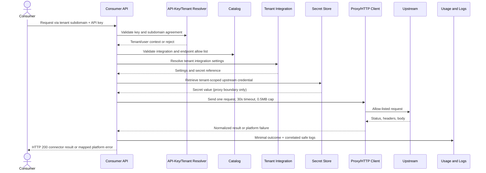

# Component Dependencies and Data Flows

## Current scope amendment (2026-10-26)

OIDC, membership, consumer API keys, tenant-private management, and proxy
execution are deferred. Current dependencies are limited to public catalog
read access and tenant host routing. The diagrams below that show
authentication or authenticated proxy flows describe future-state behavior.

## Dependency rules

- UI components call application endpoints; they do not access persistence or
  secrets directly.
- Identity and tenancy establish trusted principal/context before tenant
  data access.
- Tenant integration configuration depends on the catalog for published
  integration metadata and on the secret-store interface for credentials.
- The consumer proxy depends on tenant resolution, API-key validation,
  catalog allow-list validation, tenant integration configuration,
  secret-store interface, and outbound HTTP client.
- Catalog administration uses its owning application service and
  platform-operator authorization.
- Usage recording and security/application logging are separate contracts;
  both receive correlation context but neither receives secret values.
- PostgreSQL access belongs to each module's own persistence adapter.
  Cross-module coordination uses service contracts, not direct table access.

## Dependency matrix

| Caller | Depends on | Purpose |
|---|---|---|
| API Host | Identity, tenancy, catalog, tenant config, API keys, proxy, logging | Composition, routing, shared middleware |
| Tenant UI | Authenticated management API | Tenant membership and integration workflows |
| Operator UI | Protected operator API | Tenant bootstrap and catalog maintenance |
| Identity/Access | OIDC provider, membership repository | Authenticate principals and authorize roles |
| Tenant Provisioning | Identity/Access, tenancy repository | Create tenant and first admin |
| Catalog Service | Catalog repository, validation | Publish definitions, endpoint allow lists, OpenAPI |
| Tenant Integration Service | Catalog contract, secret-store interface, own repository | Store tenant configuration and secret references |
| API-Key Service | Tenant context, key repository | Create/validate/revoke tenant user keys |
| Proxy Service | Tenant context, API-key, catalog, tenant config, secret-store, HTTP client | Authenticate and forward allow-listed calls |
| Usage Recorder | Usage repository | Persist minimal request outcome |
| Security/Application Logger | Central logging sink | Structured security and operational events |
| Module persistence adapters | PostgreSQL via EF Core | Store only each module's owned data |
| Terraform/CI | Hosting provider, registry, GitHub Actions | Provision and deliver portable application artifact |

## Management sign-in and tenant administration

## Consumer proxy request

## Deployment boundary

The application is deployed as a modular monolith and an OCI-compatible
artifact. Terraform provisions provider-specific resources only after a
hosting provider is selected. GitHub Actions builds, validates, and promotes
the same immutable artifact; canary behavior and previous-version rollback
must be designed with the selected host. Database migrations are controlled
deployment steps. The MVP has no availability SLA; 99.95% monthly
availability and exact Warm Standby RTO/RPO are production-readiness gates.
