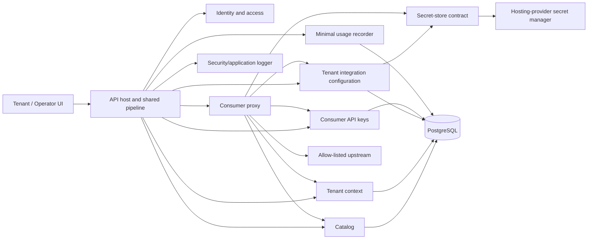

# Unit of Work Dependency Map

## Current scope amendment (2026-10-26)

All application authentication and sign-in are deferred. Current work is
public catalog discovery and host-based tenant routing only. The OIDC,
membership, consumer-key, and proxy dependency sequence below describes
future-state behavior; a tenant subdomain identifies routing context, not
access.

## Deployment relationship

All modules are part of `CentreLock Application`, a single deployable
modular monolith. There are no inter-unit calls, service contracts, or
independent rollout order. PostgreSQL and external OIDC/upstream/secret
services are dependencies of the application unit, not separate product
units.

## Module dependency matrix

| Module | Depends on | Dependency purpose |
|---|---|---|
| API host/shared pipeline | All application modules | Composition, authenticated route groups, cross-cutting middleware |
| Identity/access | OIDC provider, membership persistence | Principal validation and role authorization |
| Tenant provisioning/context | Identity/access, tenant persistence | Operator bootstrap and trusted tenant scope |
| Integration catalog | Operator authorization, catalog persistence | Protected definition, allow-list, and OpenAPI management |
| Tenant integration configuration | Tenant context, catalog contract, secret-store contract, owned persistence | Tenant-local configuration and secret references |
| Secret-store adapter | Hosting-provider secret manager (unselected) | Tenant-scoped upstream secret operations |
| Consumer API keys | Tenant context, key persistence | Creation/hash validation/owner lifecycle/admin revocation |
| Consumer proxy | Tenant context, key service, catalog, tenant config, secret-store, outbound HTTP client | Authenticated, allow-listed upstream forwarding |
| Usage recorder | Proxy outcome, usage persistence | One minimal request outcome record |
| Security/application logger | API pipeline and modules, centralized log sink | Correlated, structured, redacted operational/security events |
| Tenant management UI | Authenticated management API | Membership, integration, documentation, and key workflows |
| Operator UI | Protected operator API | Tenant provisioning and catalog management |
| Persistence adapters | PostgreSQL via EF Core | Module-owned reads/writes and controlled migrations |
| Terraform/GitHub Actions | Selected hosting provider, registry, repository | Provisioning, build, validation, canary, rollback, promotion |

## Request flow and dependency order

## Sequencing and coordination

1. **Secure foundations:** Identity and access, tenant model/context,
   operator authorization, owned persistence conventions, global validation,
   request limits, safe errors, and tenant-isolation tests.
2. **Catalog slice:** Operator authorization and catalog management, then
   tenant catalog read and OpenAPI display.
3. **Tenant configuration slice:** Tenant-scoped add/update/remove flows,
   catalog linkage, secret references, and credential redaction.
4. **Consumer key slice:** Owner key creation and lifecycle, tenant-admin
   revocation, one-way hash persistence, and cross-tenant denial tests.
5. **Proxy slice:** Tenant subdomain/key agreement, allow-list checks,
   credential retrieval, timeout/size constraints, response mapping, and
   minimal outcome recording.
6. **Integrated delivery:** Tenant/operator UI integration, controlled
   migrations, CI, Terraform, canary and previous-version rollback, and
   end-to-end verification.

The catalog/configuration and key/proxy slices can proceed as separate work
streams after the identity/tenant foundations, but both remain within one
release unit and coordinate through the approved API/module contracts.

## Integration and rollback constraints

- Use in-process application contracts between modules; no message broker or
  network service boundary is required.
- The hosting provider is unselected. Keep secret retrieval and infrastructure
  provider-specific details behind adapters and Terraform modules.
- Apply database changes as reviewed, controlled EF Core migrations. Schema
  compatibility must permit application rollback to the previous pinned
  artifact; restoring old code does not automatically reverse data changes.
- Build and validate one immutable application artifact through environments.
  Use canary/progressive rollout and previous-version infrastructure and
  application artifacts as specified in requirements.
- Verify module-level tests, tenant isolation, API contracts, PostgreSQL
  integration, UI behavior, and deployment rollback at the stated
  coordination checkpoints.
