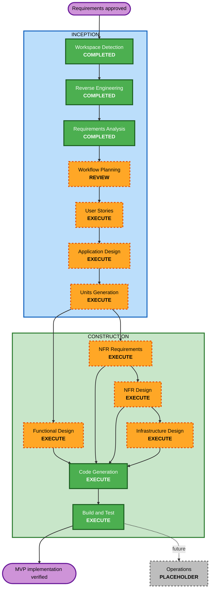

# Execution Plan

## Detailed Analysis Summary

### Transformation Scope

- **Transformation type:** Major product expansion within the accepted
  modular-monolith architecture; not a move to distributed services.
- **Primary changes:** Add tenant identity and authorization, tenant-scoped
  configuration and credentials, consumer API authentication and proxy
  behavior, and production delivery infrastructure.
- **Related components:** ASP.NET Core API, React management UI, PostgreSQL
  schema and EF migrations, API/web tests and CI, and new Terraform
  infrastructure.

### Change Impact Assessment

- **User-facing changes:** Yes. Add tenant sign-in, team membership, and
  integration management.
- **Structural changes:** Yes. Establish identity/access, tenancy, and
  consumer-proxy module boundaries inside the monolith.
- **Data model changes:** Yes. Add tenant, membership, key metadata, tenant
  integration configuration, and usage data as required by MVP scope.
- **API changes:** Yes. Add management and tenant-facing consumer API
  contracts; keep the Development-only proxy distinct.
- **NFR impact:** High. Tenant isolation, credential security, logging,
  resilience, and production delivery are cross-cutting requirements.

### Component Relationships

```text
React management UI
  -> ASP.NET Core API
      -> Identity/access and tenancy boundaries
      -> Integration catalog
      -> Tenant integration configuration and credential-provider interface
      -> Consumer proxy -> allow-listed upstream APIs
      -> PostgreSQL via EF Core
      -> structured logs and request usage records
Terraform / GitHub Actions
  -> build and deploy the application and PostgreSQL infrastructure
API and web test suites
  -> validate contracts, authorization, isolation, proxy behavior, and UI
```

The API remains the application boundary; modules must use explicit
contracts rather than another module's persistence internals. The hosting
provider is not selected. Keep cloud-specific resources and secret-manager
integration behind provider/deployment boundaries until that decision is
made. The accepted ADR describes a single application deployment with the
UI built and served with the application; the current local Compose setup
uses a separate Nginx UI container, so reconcile production packaging during
Application Design.

### Risk Assessment

- **Risk level:** High. Tenant isolation, consumer credentials, and outbound
  proxying create security-sensitive cross-cutting behavior.
- **Rollback complexity:** Moderate. Version-pinned application/infrastructure
  rollback is required; schema changes need compatible migrations and a
  documented rollback strategy.
- **Testing complexity:** Complex. Requires unit, property-based, API,
  database, tenant-isolation, proxy, and browser-level tests.

## Workflow Visualization



## Phases to Execute

### INCEPTION

- [x] Workspace Detection
- [x] Reverse Engineering
- [x] Requirements Analysis
- [x] Workflow Planning - approved
- [ ] User Stories - **EXECUTE**. Multiple user groups and user-facing
  workflows need acceptance criteria.
- [ ] Application Design - **EXECUTE**. Define new application modules,
  contracts, and integration boundaries.
- [ ] Units Generation - **EXECUTE**. Tenant data models, API contracts, and
  Terraform work span multiple components.

### CONSTRUCTION

- [ ] Functional Design - **EXECUTE**. Specify unit behavior and testable
  properties before implementation.
- [ ] NFR Requirements - **EXECUTE**. Refine security, privacy, reliability,
  and property-based testing requirements for implementation.
- [ ] NFR Design - **EXECUTE**. Design the cross-cutting security and
  resilience controls.
- [ ] Infrastructure Design - **EXECUTE**. Design Terraform and delivery
  workflows; keep provider-specific implementation pending hosting selection.
- [ ] Code Generation - **EXECUTE**. Implement planned units.
- [ ] Build and Test - **EXECUTE**. Validate the integrated MVP.

### OPERATIONS

- [ ] Operations - **PLACEHOLDER**. Operations-stage workflows are not yet
  defined.

## Module Update Strategy

- **Update approach:** Hybrid, in independently testable slices within one
  modular monolith.
- **Critical path:** User stories and application contracts -> tenant/data
  model and authorization boundaries -> tenant configuration and proxy ->
  management UI integration -> production infrastructure and release workflow.
- **Coordination points:** Tenant identity and request context; database
  migrations; API contracts; credential-provider interface; UI/API packaging;
  CI and Terraform environment boundaries.
- **Testing checkpoints:** Validate domain and authorization behavior first;
  then database/API integration; then end-to-end UI/proxy behavior; finally
  deployment and rollback checks.
- **Rollback:** Roll back to the previous version-pinned application and
  infrastructure artifact. Use backward-compatible migrations or a
  deliberate database rollback plan; do not assume application rollback
  reverses data changes.
- **Package sequencing:** Define API/domain contracts and migrations before
  dependent UI flows. Add tests alongside each slice. Keep the existing
  Development catalog/proxy behavior covered and distinct from authenticated
  tenant routes.

## Estimated Timeline

- **Planned stages:** 10, including User Stories, Application Design, Units
  Generation, the four applicable design stages, Code Generation, and Build
  and Test; Workflow Planning is the current review stage.
- **Duration:** Not estimated. Implementation sizing and hosting-provider
  selection are not yet available.

## Success Criteria

- **Primary goal:** Deliver the defined tenant-management and consumer-proxy
  MVP within the accepted modular-monolith architecture.
- **Key deliverables:** Approved user stories and designs; tenant-safe
  identity, configuration, and proxy units; automated tests; Terraform and
  GitHub Actions delivery changes as applicable.
- **Quality gates:** Tenant isolation and credential handling verified;
  Security Baseline and full PBT requirements addressed; required CI passes;
  production-readiness gates for availability, recovery objectives, and GDPR
  retention/access are documented and not misrepresented as MVP guarantees.
