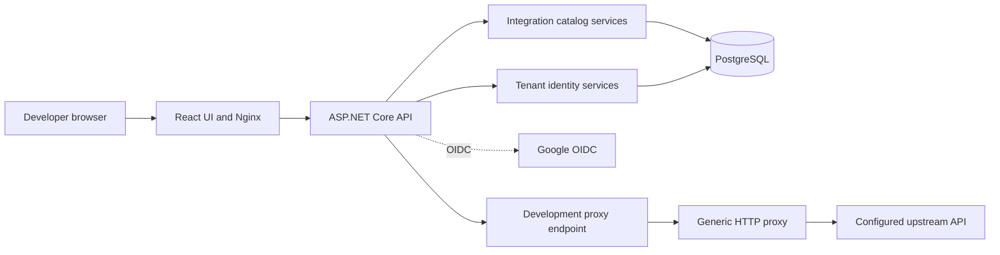
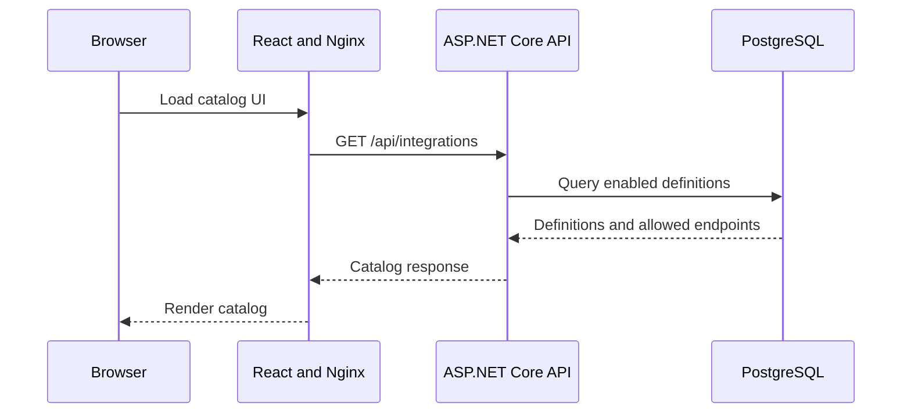
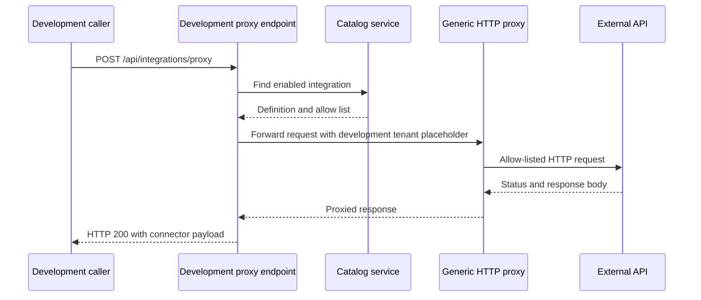

# System Architecture

## System Overview

The repository currently implements a .NET modular-monolith foundation: one ASP.NET Core API, a React/TypeScript UI, and PostgreSQL persistence for the integration catalog and tenant identity. Docker Compose runs PostgreSQL, API, and Nginx-served UI containers locally. The logical catalog, proxy, and identity boundaries are present inside the API. Google OIDC sign-in, tenant memberships, platform-operator tenant provisioning, and a membership-gated tenant catalog read API are implemented. Tenant isolation beyond membership checks, tenant integration management, consumer API authentication, billing, and production hosting are not implemented. A non-production Google Cloud (GCP) delivery path (Terraform, Cloud Run, shared Cloud SQL) is implemented; production hosting is not.

The accepted product direction is a portable .NET modular monolith with PostgreSQL, a React UI, OCI-compatible packaging, and provider-neutral hosting. The ADR and architecture overview also describe CI/CD and future module boundaries; they do not mean those features exist in the current code.

## Current Architecture Diagram

Text alternative: In local Compose, the browser loads the React application from Nginx. Nginx forwards `/api` and `/swagger` requests to the API. The API reads the catalog and tenant identity data from PostgreSQL, performs Google OIDC sign-in when configured, and can route Development proxy requests through the generic HTTP proxy to an allow-listed upstream.

## Component Descriptions

### ASP.NET Core API (`src/CentreLock.Api`)
- **Purpose**: API host and composition root.
- **Responsibilities**: Configure PostgreSQL/EF Core (catalog and identity contexts), authentication, catalog/proxy services, named `HttpClient`, Swagger, CORS, safe-exception, security-header, and cookie-session CSRF middleware, health (`/api/health`) and readiness (`/api/ready`, checks both database contexts) endpoints, and Development-only routes. Serve built UI static files outside Development. Optionally apply EF migrations at startup when `Database:MigrateOnStartup` is true (used for non-production cloud environments only). Seed Star Wars idempotently at startup in every environment.
- **Dependencies**: Catalog and proxy modules, PostgreSQL through EF Core/Npgsql, external HTTP APIs through `HttpClient`.
- **Type**: Application.

### Integration catalog (`Integrations/Catalog`)
- **Purpose**: Represent and persist platform-managed integration definitions.
- **Responsibilities**: Define catalog entities and input validation; store definitions and owned endpoint records; list/find enabled definitions; seed Star Wars; expose Development list and OpenAPI routes and authenticated tenant list/OpenAPI routes (`/api/tenant/integrations`), which require a tenant membership and return the same platform-wide enabled catalog.
- **Dependencies**: EF Core, PostgreSQL, API host.
- **Type**: Application/data access.

### Tenant identity (`Identity`)
- **Purpose**: Authenticate users and map them to tenants.
- **Responsibilities**: Google OpenID Connect sign-in (authorization code flow) with a `__Host-CentreLock` cookie session. Sign-in is allowed only for identities with a verified email and either a tenant membership or a configured platform-operator subject (`PlatformOperators:SubjectIds`); a first-time operator is registered on sign-in. Persists identities, tenants (validated slug), and memberships with roles `Admin` or `Member` in a separate EF Core context/migration. Exposes `/api/auth/status`, `/api/auth/csrf`, `/api/auth/sign-in`, `/api/auth/sign-out`, `/api/me`, and operator-only `POST /api/operator/tenants`, which creates a tenant and makes the operator its `Admin`. Cookie-authenticated unsafe requests require an antiforgery token (`X-CSRF-TOKEN`). Outside Development/Testing the API fails at startup if Google client configuration is absent; otherwise sign-in endpoints return `503 sign_in_not_configured`.
- **Dependencies**: EF Core, PostgreSQL, Google OIDC.
- **Type**: Application/data access.
- **Gaps**: No invitation or membership-management API, no Admin/Member authorization differences, no per-tenant data isolation or row-level security, and no tenant-scoped integration configuration.

### Integration proxy (`Integrations/Proxy`)
- **Purpose**: Apply catalog configuration to outbound HTTP requests.
- **Responsibilities**: Match normalized methods and decoded path segments against allowed endpoint templates; build an upstream URI from the configured base URL; forward query, body, content type, and Accept; obtain tenant-scoped credentials through an interface for API-key or bearer schemes; return upstream status/body/content type. The current Development route rejects integrations that require credentials before calling this service.
- **Dependencies**: Catalog interface, credential-provider interface, named `HttpClient`.
- **Type**: Application/integration adapter.

### Web UI (`web`)
- **Purpose**: Preview integrations, allowed endpoints, and documentation; show sign-in state.
- **Responsibilities**: Show sign-in/sign-out and the signed-in account's tenant memberships; fetch the tenant catalog for members and otherwise the Development catalog, display loading/empty/error states and selected integration details, link to OpenAPI and Swagger.
- **Dependencies**: React, TypeScript, Vite for development/build, Nginx in the local container.
- **Type**: Web application.

### PostgreSQL (`compose.yaml`)
- **Purpose**: Local persistence for integration catalog and tenant identity records.
- **Responsibilities**: Store catalog definitions, allow-list entries, identities, tenants, and memberships using separate EF Core migrations.
- **Dependencies**: API container and EF Core/Npgsql.
- **Type**: Data store.

### Test and CI components
- **Purpose**: Validate application behavior and deliverable builds.
- **Responsibilities**: xUnit and ASP.NET Core test host; optional PostgreSQL integration tests; Bruno API collection; Playwright UI tests; GitHub Actions build/test/audit workflow and main-push context-review dispatch.
- **Type**: Test/infrastructure.

## Data Flow

### Development catalog browsing

Text alternative: The Development UI calls the API, which reads enabled integration definitions and endpoint entries from PostgreSQL and returns them for display.

### Development proxy call

Text alternative: The Development-only endpoint resolves an enabled catalog entry, rejects credentialed entries, and invokes the generic proxy. The proxy validates the method/path, sends the request to the configured upstream, and the endpoint wraps the response. Unknown integration, disallowed path, transport error, and timeout have distinct error responses.

## Integration Points

- **External APIs**: `https://swapi.dev/api/` is the seeded Star Wars API used by the Development proxy. GitHub is a product candidate, but MVP inclusion and authorization are deferred; no GitHub catalog entry or provider-specific behavior exists in the tracked implementation.
- **Database**: PostgreSQL via EF Core/Npgsql, with integration-catalog and tenant-identity migrations.
- **Third-party services**: Google OIDC is integrated for sign-in. In the non-production GCP environments, Secret Manager holds the database admin password. No billing provider or tenant-credential secret manager is integrated.

## Infrastructure Components

- **Containers**: Dockerfile builds a .NET API runtime and a separate Nginx web runtime from a shared build context.
- **Local deployment**: Compose defines API, UI, and PostgreSQL services. The web Nginx configuration proxies `/api` and `/swagger` to the API service.
- **CI**: `.github/workflows/ci.yml` runs .NET formatting and tests, PostgreSQL-backed tests, Compose/Bruno checks, and separate web lint/build/Playwright checks with npm audits.
- **Context-review dispatch**: `.github/workflows/cd.yml` dispatches `context-update-review.yml` on pushes to `main`, passing the source commit SHA; it does not deploy the application.
- **Container targets**: The Dockerfile adds a `cloud-run-runtime` target (API image with the built web assets in `wwwroot`) alongside the separate `api-runtime` and `web-runtime` targets used by Compose.
- **Non-production GCP delivery (implemented, `infrastructure/` and `.github/workflows/`)**: Four Terraform roots with remote state in a GCS bucket: `state` (bucket; local state migrated manually), `bootstrap` (manual one-time apply: Artifact Registry, Cloud Run runtime service account, GitHub Workload Identity Federation for this repository, and three scoped pipeline identities for preview, staging, and shared infrastructure), `shared` (pipeline-applied: shared Cloud SQL PostgreSQL 16 instance, admin password in Secret Manager, lease controller), and `environment` (one Cloud Run service plus one database per environment, named `pr-<n>` or `staging`). Region is `europe-west2`.
- **Database lease**: The shared Cloud SQL instance is stopped by default. A Cloud Run function lease controller (`/renew`, `/expire`, `/status`) starts it for at most 60 minutes per call, and a Cloud Scheduler job stops it after the lease lapses. Pipelines call `.github/scripts/renew-lease.sh` before steps that need the database.
- **Workflows**: `deploy-preview.yml` (same-repository PRs only: build image, apply a `pr-<n>` environment, smoke test `/api/ready`; destroy on close), `deploy-staging.yml` (push to `main`: build and apply `staging`, smoke test), `deploy-infrastructure.yml` (push to `main` touching `infrastructure/shared/`; approval-gated `shared-infrastructure` environment), and `terraform-validate.yml` (format, backend-less init, validate for all four roots on PRs). Preview and staging workflows are disabled until the `LEASE_CONTROLLER_URL` repository variable is set. Each environment builds its own image; there is no promotion of one immutable artifact and no production environment.
- **Non-production limitations**: Migrations run at app startup (`Database:MigrateOnStartup`) and the database password is kept in Terraform state and service configuration; both are documented as acceptable for non-production only. Preview/staging services allow public ingress. Previews are checked only by a readiness smoke test, not the full API suite.
- **Networking**: Local ports are API `8080`, UI `5173`, and PostgreSQL `5432`. These are development settings, not production deployment requirements. Nginx forwards the original `Host` header (`$http_host`) to the API. Local Compose reads `CENTRELOCK_GOOGLE_CLIENT_ID`, `CENTRELOCK_GOOGLE_CLIENT_SECRET`, and `CENTRELOCK_PLATFORM_OPERATOR_SUBJECT` for sign-in.

## Architecture Boundaries and Gaps

The architecture overview and ADRs establish tenant isolation, module contracts, platform ownership of the catalog, and portable delivery as constraints. They remain largely future work in code. Identity and membership exist, but there is no tenant-resolution boundary for tenant-owned data, no row-level security, and no role-based authorization beyond membership and the platform-operator policy; tenant-specific credentials are not persisted; the registered credential provider is deliberately unconfigured; and there is no usage/billing module.

The delivery shape is split: ADR 0001 and the architecture overview describe the UI as built and served with the application, which the `cloud-run-runtime` image does for cloud environments, while Compose still runs the Nginx UI and API as separate containers.
