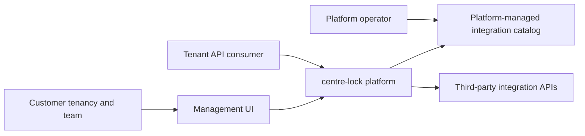

# Business Overview

## Business Context

centre-lock's product goal is a B2B integrations platform. Customer organizations (tenancies) should configure and consume integrations through a management UI and a tenant-specific API surface. The platform operator owns the shared integration catalog and its endpoint allow lists; tenants choose from available integrations but do not control the catalog. Upstream services remain external to centre-lock.

This product context comes from `aidlc-docs/inception/requirements/product-requirements.md`. The workflows listed below distinguish current implementation from intended product behavior; examples and open questions are not treated as settled requirements.

### Context Diagram

Text alternative: The platform operator manages integration definitions. A customer's team is intended to manage its tenancy through the UI, and its API consumers are intended to call centre-lock, which proxies to third-party APIs using catalog-controlled integration details.

## Business Description

- **Business Description**: Provide a centrally managed platform for customers to configure and consume third-party integrations while isolating each customer tenancy.
- **Business Transactions in the current implementation**:
  - On API startup, add the Star Wars API definition to PostgreSQL if its slug is absent. The seed runs in all environments; catalog and OpenAPI routes are public in every environment; the development proxy is mapped only in Development or when `Integrations:EnableProxy` is enabled.
  - In any environment, list enabled catalog integrations and retrieve their stored OpenAPI documents without authentication.
  - In Development (or with the proxy flag), submit a proxy request for an enabled integration that requires no upstream credentials. The proxy enforces the catalog's method/path allow list and wraps the upstream status and response body in a `connector` response object.
  - Check API liveness using `GET /api/health`.
- **Product transactions described by the specification but not implemented yet**:
  - Authenticate a tenant user and enforce membership, role, and tenant isolation.
  - Let tenant administrators configure available integrations and view their documentation.
  - Authenticate tenant API consumers with tenant-scoped API keys and proxy requests to configured integrations.
  - Retrieve tenant-specific upstream credentials, record usage, and provide tenant usage and billing information.
  - Manage platform catalog definitions and endpoint allow lists through an authorized operator workflow.
- **Business Dictionary**:
  - **Tenancy**: One customer organization and the product's isolation boundary.
  - **Integration catalog**: Platform-managed definitions, authentication settings, endpoint allow lists, and OpenAPI documents.
  - **Tenant integration**: A tenant's configured use of an integration selected from the central catalog.
  - **Consumer API key**: A tenant-scoped credential for a consumer calling centre-lock, distinct from upstream credentials.
  - **Upstream credential**: A tenant-specific credential used by the proxy to authenticate to an external integration.
  - **Billable request**: The specification says every API request is billable, including unsuccessful and timed-out requests; the per-request amount is unresolved.

## Component-Level Business Descriptions

### ASP.NET Core API
- **Purpose**: Serves health, public catalog/OpenAPI, and flag-gated Development proxy routes.
- **Responsibilities**: Seed the catalog, compose catalog/proxy services, map the current API surface, and expose Swagger.

### Integration catalog
- **Purpose**: Store centrally managed integration definitions in PostgreSQL.
- **Responsibilities**: Persist definitions and endpoint allow lists; query enabled definitions; seed the Star Wars API.

### Integration proxy
- **Purpose**: Forward allowed requests to an upstream HTTP API.
- **Responsibilities**: Resolve the enabled catalog definition, enforce method/path allow lists, attach supported tenant-specific authentication when configured, enforce a 30-second HTTP client timeout, and return upstream response data.

### React management UI
- **Purpose**: Provide a Development catalog preview.
- **Responsibilities**: Browse enabled catalog entries, allowed endpoints, and OpenAPI/Swagger links. Tenant sign-in and tenant integration management are explicitly not available yet.

### PostgreSQL
- **Purpose**: Persist the integration catalog.
- **Responsibilities**: Store integration definitions and associated allowed endpoints. Tenant identity, tenant-owned configuration, credentials, and usage records are not represented in the current schema.

### Test and delivery components
- **Purpose**: Validate current backend, API, persistence, and UI behavior.
- **Responsibilities**: xUnit/API-host tests, PostgreSQL-backed catalog tests, Bruno API requests, Playwright UI tests, Docker Compose, and GitHub Actions CI.
