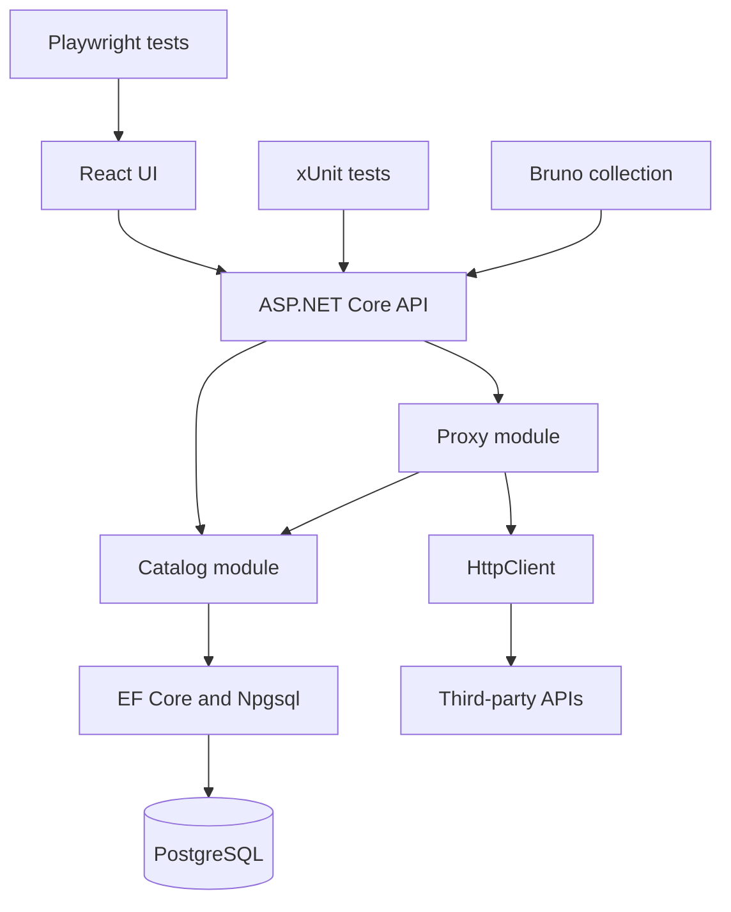

# Dependencies

## Internal Dependency Diagram

Text alternative: The UI and API tests call the API surface; the API uses catalog and proxy modules. Catalog persistence uses EF Core/Npgsql with PostgreSQL. The proxy uses the catalog and outbound `HttpClient`. Playwright drives the UI.

## Internal Dependencies

### API host depends on catalog module
- **Type**: Compile-time/runtime.
- **Reason**: Registers the catalog service, seeds Star Wars, and maps Development catalog routes.

### API host depends on proxy module
- **Type**: Compile-time/runtime.
- **Reason**: Registers the generic proxy and maps its Development endpoint.

### Catalog module depends on EF Core/Npgsql and PostgreSQL
- **Type**: Compile-time/runtime.
- **Reason**: Persist definitions and endpoint allow lists; provide EF migrations and catalog queries.

### Proxy module depends on catalog and HTTP client factory
- **Type**: Compile-time/runtime.
- **Reason**: Resolve the configured upstream and allow list, then issue the outbound HTTP request.

### Proxy module depends on credential-provider interface
- **Type**: Runtime interface.
- **Reason**: Retrieve tenant/integration-scoped upstream credentials for API-key or bearer authentication. The production implementation is not configured.

### Test projects depend on the application
- **Type**: Test-time.
- **Reason**: Exercise endpoint, validation, proxy, startup, and PostgreSQL behavior.

### Bruno collection depends on running API/Compose services
- **Type**: Test-time.
- **Reason**: Assert external HTTP contract behavior. Live-tagged calls additionally depend on the public Star Wars service.

### Playwright suite depends on web build/dev server
- **Type**: Test-time.
- **Reason**: Verify visible catalog UI behavior using route-mocked API data.

## External Dependencies

- **PostgreSQL** - Persistent store for the current catalog.
- **Star Wars API** - Configured upstream target for the seeded integration and live smoke cases.
- **Docker Hub/Microsoft container images** - Node, Nginx, .NET SDK/runtime, and PostgreSQL build/runtime bases.
- **NuGet packages** - EF Core, Npgsql, Swagger, test host, xUnit, and test tooling.
- **npm packages** - React, TypeScript, Vite, Oxlint, Playwright, Bruno CLI, and transitive dependencies.
- **GitHub Actions** - CI runner, checkout/setup actions, and repository workflows.

External package licensing has not been inventoried in this initial analysis.
